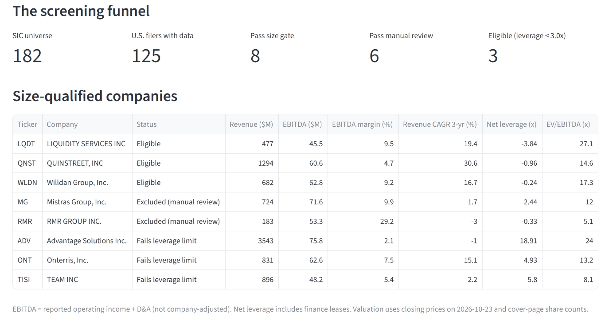
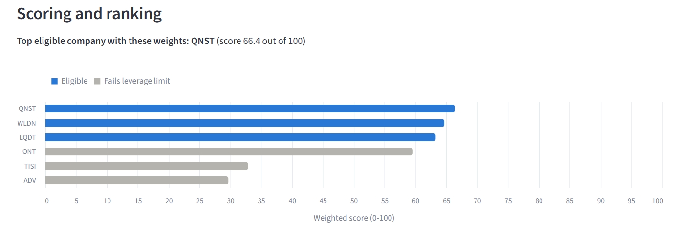
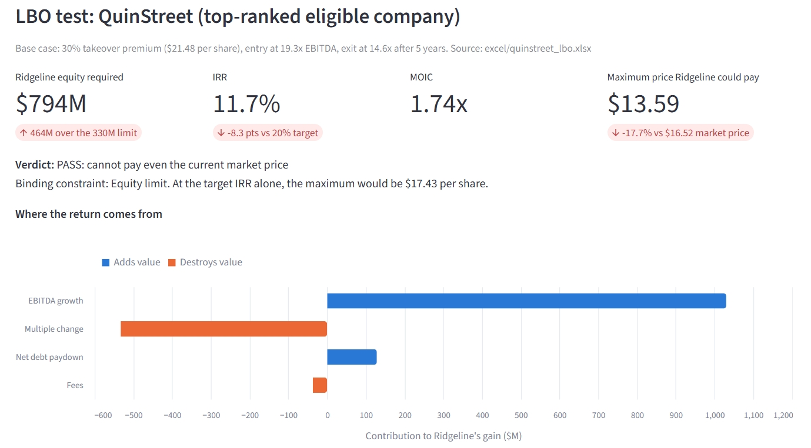

# AI-Powered Private Equity Deal Screening Engine

A private equity–style deal screen for U.S.-listed B2B services companies, built from SEC filings: it collects financial data, calculates PE screening metrics, filters and ranks companies against a fund mandate, tests the top candidate with an LBO model, and presents the results in an interactive dashboard and an investment committee memo.

> **Ridgeline Capital is a fictional $2B fund** created for this portfolio project. All company data comes from public SEC filings; share prices are Nasdaq.com closes as of October 23, 2026. Nothing here is investment advice.



## Result in one paragraph

From **182** listed companies in ten business-services industry codes, the screen narrowed to **3 eligible candidates**. The top-ranked one, **QuinStreet (QNST)**, was tested with an LBO model. On conservative assumptions, a buyout at a 30% premium returns **11.7% IRR**, below the fund's 20% target; on a management-informed case, it returns **25.7%**. Either way, the deal needs **~$794M of equity, versus the fund's $330M limit**, so the memo recommends **passing and adding QuinStreet to a watch list**, and spells out the conditions that would change that view.

## What this project demonstrates

- **Financial statement analysis:** EBITDA, free cash flow, cash conversion, CapEx intensity, net debt and leverage (including finance leases), DSO, ROIC with and without goodwill, enterprise value, and EV/EBITDA.
- **Verified automation:** every metric was first calculated by hand in Excel for a real company (Mistras Group), and the Python pipeline was validated against it: **32 of 32 metrics match**.
- **Real-world data problems, handled and documented:** changing XBRL tags, fiscal year-end changes, 52/53-week years, custom tags missing from SEC data, hidden debt, and foreign filers.
- **PE judgment:** a written mandate, a documented exclusion reason for every company, a hard filter vs. preferences, sensitivity analysis on scoring weights, and the gap between reported and "adjusted" EBITDA.
- **LBO modeling:** sources and uses, a debt schedule with cash sweep, returns (IRR, MOIC), a value-creation bridge, and a direct solve for the maximum price the fund could pay.
- **Tools:** Python (pandas), SQL (SQLite), Excel, the SEC EDGAR API, Streamlit, and Git.
- **AI-assisted research with human verification:** qualitative analysis drafted with AI, with every claim checked against primary SEC filings.

## How the screen works

| Stage | Companies | How |
|---|---|---|
| Universe: NYSE/Nasdaq companies in 10 business-services SIC codes | 182 | SEC company profiles |
| U.S. filers with usable 10-K data | 125 | Foreign private issuers (20-F/40-F) and companies without annual data excluded, each with a reason |
| Size gate: EBITDA $40–100M in the latest fiscal year (2025 or later) | 8 | Sized to the fund: $2B fund → $200–330M equity per deal |
| Manual review against the mandate | 6 | Excluded: a company under an announced acquisition, and an asset manager |
| Eligible: net leverage below 3.0x | 3 | Hard filter |
| Weighted score → LBO on the top candidate | 1 | Six metrics, fixed scales tied to the mandate |





## Repository guide

| Folder | Contents |
|---|---|
| `docs/` | Investment mandate, data dictionary, manual review, scoring methodology, AI-assisted analysis (with claim register), dashboard screenshots |
| `reports/` | Investment committee memo on QuinStreet |
| `excel/` | Mistras answer key (manual validation model) and QuinStreet LBO model |
| `src/` | Reusable Python: `sec_extract.py` (SEC data extraction), `metrics.py` (screening metrics and valuation), `scoring.py` (scoring model) |
| `notebooks/` | The pipeline, step by step (`01`–`07`), from SEC API exploration to scoring |
| `sql/` | Size gate and mandate scorecard as SQL queries, cross-checked against Python |
| `dashboard/` | Streamlit app |
| `data/` | Processed datasets, the SQLite database, share prices, and documented manual adjustments |

## How to run it

Requires Python 3.11 and Git.

```bash
git clone https://github.com/Reethika-Bollaboyana/pe-deal-screening-engine.git
cd pe-deal-screening-engine
python -m venv .venv
.venv\Scripts\activate            # Windows (macOS/Linux: source .venv/bin/activate)
pip install -r requirements.txt
```

1. **Identify yourself to the SEC.** The SEC requires a User-Agent with a name and email. Copy `.env.example` to `.env` and fill in your details. (`.env` is excluded from Git.)
2. **Rebuild the data** (optional; processed results are already included): run notebooks `02` → `07` in order. Notebook `03` downloads about 180 SEC files (a few minutes, cached locally).
3. **Launch the dashboard:**
   ```bash
   streamlit run dashboard/app.py
   ```

## Key methodology choices

- **EBITDA = reported operating income + D&A.** Company-defined "Adjusted EBITDA" is not used, so stock-based compensation counts as a cost. This is the single biggest driver of how expensive a company looks (QuinStreet: 14.6x strict vs. 7.9x on the company's adjusted figure).
- **Debt includes finance leases** (a switch in the model); operating leases are excluded.
- **Missing data stays missing.** Blanks are never silently filled with zero; where a zero is assumed (e.g., no acquisition line reported), it is documented.
- **Manual overrides are explicit:** one documented adjustment (`data/manual/manual_adjustments.csv`) covers an acquisition reported under a custom XBRL tag.

Full details: `docs/data_dictionary.md` and `docs/scoring_methodology.md`.

## Limitations

- Public companies serve as proxies for private targets; real middle-market PE deals are mostly private.
- Annual figures are combined with a single day's share prices.
- The LBO model is simplified (one loan, flat interest rate, simple taxes), and its projections are judgments, not forecasts.
- SEC XBRL data has gaps (custom tags, inconsistent tagging); known gaps are documented where found.

## Author

**Reethika Bollaboyana** · [GitHub](https://github.com/Reethika-Bollaboyana)
